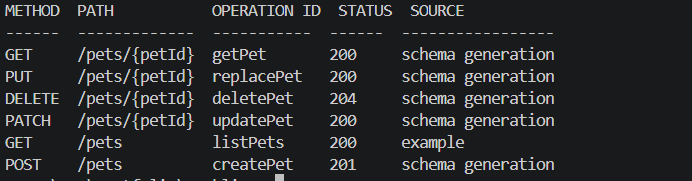

# Mockline

Mockline is a local-first OpenAPI mock server and TypeScript library. Point it at
an OpenAPI 3 document to serve documented routes, choose examples or generate
schema-conforming responses, validate requests, and optionally keep CRUD state
in memory. It uses Node's built-in HTTP server and binds to loopback by default.

> **npm package:** `@zahidhasann/mockline`. The unscoped name is already taken;
> the command is still `mockline`. Use the local build until the first release.

## Highlights

- OpenAPI 3.0/3.1 YAML and JSON loading, route listing, validation, and warnings
  for features that cannot be mocked automatically.
- Example-first or seeded schema generation; generated values are repeatable for
  the same seed, route, method, and request counter.
- Request validation for path, query, header, cookie, and JSON body parameters;
  `off`, `warn`, and `strict` modes.
- Optional in-memory REST collection detection for list/create/get/replace/
  patch/delete operations, including seed data and pagination.
- Per-operation response overrides, conditional rules, sequences, latency, and
  injected errors.
- Request recording with sensitive-header redaction, a local inspector API,
  and opt-in JSONL persistence.
- Optional upstream proxying for unmatched routes or all requests, with private
  and link-local destinations blocked by default.
- Atomic OpenAPI/config hot reload, graceful shutdown, bounded request bodies,
  and configurable HTTP timeouts.
- ESM-only, typed programmatic API; no Express or other HTTP framework.

Mockline is for local development, tests, and demos—not production traffic.

## Preview



Route listings show each operation's default response status and whether its response comes from an example or schema generation.

## Requirements and installation

- Node.js 20 or newer.
- pnpm 9 for working from this repository; npm can be used to install a
  published package.

After the first npm release:

```sh
npm install --global @zahidhasann/mockline
mockline --help
```

To work from a clone before publishing:

```sh
corepack pnpm install
corepack pnpm build
node dist/cli.js --help
```

## Quick start

Create a starter config and OpenAPI document in an empty directory:

```sh
mockline init
mockline routes openapi.yaml
mockline validate openapi.yaml
mockline serve openapi.yaml
```

The server prints its URL (default `http://127.0.0.1:4010`). Try the starter
route at `GET /pets`, or use `GET /pets?limit=5`. The inspector is available on
the loopback bind at `GET /__mockline/health`.

To use the checked-in Petstore example from the repository root:

```sh
mockline routes examples/petstore/openapi.yaml
mockline validate examples/petstore/openapi.yaml
mockline serve examples/petstore/openapi.yaml \
  --config examples/petstore/mockline.yaml --port 4010
```

`--port 0` asks the operating system to choose a free port. Use `--host
127.0.0.1` explicitly when running in an environment where the bind address is
important.

## CLI

```text
mockline init [--force]
mockline serve <spec> [options]
mockline routes <spec>
mockline validate <spec>
```

`serve` options:

| Option                               | Description                                                                                             |
| ------------------------------------ | ------------------------------------------------------------------------------------------------------- |
| `--config <file>`                    | Read YAML/JSON config; otherwise discover `mockline.yaml`, `.yml`, or `.json` in the current directory. |
| `--port <port>`                      | Listen on this port; `0` selects a free port.                                                           |
| `--host <host>`                      | Bind address. Defaults to `127.0.0.1`.                                                                  |
| `--seed <n>`                         | Set the deterministic generation seed.                                                                  |
| `--prefer <example\|generate>`       | Choose examples or generated data when both are available.                                              |
| `--validate <off\|warn\|strict>`     | Set request validation behavior.                                                                        |
| `--stateful`                         | Enable detected in-memory REST collections.                                                             |
| `--delay <ms\|min-max>`              | Add fixed or uniformly distributed latency in milliseconds.                                             |
| `--error-rate <0..1>`                | Probability of injecting an error response.                                                             |
| `--error-statuses <codes>`           | Comma-separated failure statuses, e.g. `500,503`.                                                       |
| `--proxy <url>`                      | Forward unmatched requests to an HTTP(S) upstream.                                                      |
| `--proxy-all`                        | Forward all non-inspector requests to the upstream. Requires `--proxy`.                                 |
| `--proxy-record <file>`              | Save upstream responses as JSON examples for later OpenAPI editing.                                     |
| `--proxy-allow-private`              | Allow private/loopback upstream addresses; use only for a trusted upstream.                             |
| `--watch`                            | Reload valid OpenAPI/config changes without restarting.                                                 |
| `--record-file <path>`               | Append request records as JSON Lines.                                                                   |
| `--enforce-auth`                     | Require the presence of credentials declared in OpenAPI security schemes. Does not verify credentials.  |
| `--seed-counter`                     | Vary seeded responses across repeat requests.                                                           |
| `--cors` / `--no-cors`               | Enable (default) or disable CORS.                                                                       |
| `--inspector`                        | Explicitly enable the inspector on a non-loopback bind.                                                 |
| `--quiet`, `--verbose`, `--no-color` | Adjust terminal logging.                                                                                |

Run `mockline serve --help` or `mockline --help` for the generated help text.

## Response selection and controls

For each matched operation, Mockline chooses the default documented response
status, negotiates a response media type from `Accept`, and then:

1. Uses an OpenAPI example by default when one is available.
2. Otherwise generates a response from its JSON Schema.
3. Returns an empty/default body if the operation has neither a schema nor an
   example.

Set `prefer: generate` (or `--prefer generate`) to generate instead of using
examples. `Prefer: example=<name>` can select a named example. `Prefer:
code=404` or `X-Mockline-Status: 404` selects a documented status. When control
headers are enabled, `X-Mockline-Delay: 25` adds a 25 ms delay and
`X-Mockline-Error: true` forces an injected error. The requested error code is
the first configured `errors.statuses` value. These controls are intended for
trusted test clients; disable them with `controlHeaders.allow: false` when
clients should not be able to alter mock behavior.

A seeded response is deterministic for a given operation unless
`generation.counter`/`--seed-counter` is enabled. Supported JSON Schema
constraints include primitive types, enum/const/default/example values, common
formats, numeric and string limits, arrays, object properties, compositions,
discriminators, and recursive references with a depth limit. Unsupported or
non-JSON response media types need explicit examples; otherwise the server
returns a clear `501` response and `mockline validate` reports a warning.

See [response behavior](docs/behavior.md), [generation](docs/generation.md), and
[stateful limitations](docs/stateful.md) for the precise rules.

## Configuration

`mockline init` creates a commented `mockline.yaml`. A complete schema is in
[`docs/config.schema.json`](docs/config.schema.json); see
[`docs/configuration.md`](docs/configuration.md) for field meanings, defaults,
overrides, and examples.

A minimal config:

```yaml
port: 4010
host: 127.0.0.1
seed: 42
prefer: example
validate: warn
stateful:
  enabled: true
  seedItems: 3
```

CLI options override the corresponding config fields. The config file is
reloaded by `--watch`; the bound `host` and `port` cannot be changed without a
restart.

## Stateful mode

Enable `stateful.enabled` or pass `--stateful` to let Mockline detect conventional
collection pairs in the OpenAPI document: a `GET` list response with an array
schema, a `POST` on the same path, and a `GET` item route whose response schema
matches the array's item schema and declares the configured ID property. Matching
`PUT`, `PATCH`, and `DELETE` item operations are handled too. Collections live
only in memory; `stateful.seedItems` controls the initial seeded count, and
`limit`/`offset` query parameters are honored when declared by the list
operation. `POST /__mockline/reset` clears runtime state and regenerates seeds.

The collection detector is intentionally structural, not a general workflow
engine. Operations that do not match the described shape continue to use normal
example/schema response selection.

## Request validation and auth

- `off`: skip request validation.
- `warn` (default): serve the selected response, add
  `X-Mockline-Validation: failed`, and include issues in request records.
- `strict`: return an RFC 9457 `application/problem+json` response (`400` for
  parameter/content-type issues, `422` for invalid/missing request bodies).

`--enforce-auth` checks that a credential required by the operation's declared
OpenAPI security scheme is present. It does not validate API keys, JWTs,
passwords, scopes, or certificates and is not an authorization system.

## Programmatic API

```ts
import { createMockServer } from '@zahidhasann/mockline';

const server = await createMockServer({
  spec: './openapi.yaml',
  port: 0,
  seed: 42,
  config: {
    validate: 'strict',
    stateful: { enabled: true, seedItems: 2 },
  },
});

try {
  const response = await fetch(`${server.url}/pets`);
  console.log(await response.json());
  console.log(server.requests({ method: 'GET' }));
} finally {
  await server.close();
}
```

`createMockServer` returns the actual `url`, a typed `requests(filter?)` accessor
(with `.get(id)` and `.clear()`), `reset()`, `setOverride(key, override)`, and
`close()`. Close each instance when finished so watchers, sockets, and queued
writes are drained. `reset()` clears state/sequence/counters; it does not clear
the request history.

See [`examples/programmatic.ts`](examples/programmatic.ts); the package includes
declarations for the complete typed API.

A Vitest test can assert recorded requests without a global server:

```ts
import { expect, it } from 'vitest';
import { createMockServer } from '@zahidhasann/mockline';

it('records a request', async () => {
  const server = await createMockServer({ spec: './openapi.yaml', port: 0 });
  try {
    await fetch(`${server.url}/pets`);
    expect(server.requests({ method: 'GET' })).toHaveLength(1);
  } finally {
    await server.close();
  }
});
```

## Inspector and recording

On a loopback bind, the inspector is enabled by default. Its endpoints are:

| Method   | Path                       | Purpose                                                                                                 |
| -------- | -------------------------- | ------------------------------------------------------------------------------------------------------- |
| `GET`    | `/__mockline/health`       | Health and operation count.                                                                             |
| `GET`    | `/__mockline/spec`         | OpenAPI summary, schemas, and warnings.                                                                 |
| `GET`    | `/__mockline/config`       | Effective config with upstream URLs and local file paths redacted.                                      |
| `GET`    | `/__mockline/requests`     | Recent records; supports `method`, `path`, `status`, `operationId`, `since`, and `limit` query filters. |
| `GET`    | `/__mockline/requests/:id` | One in-memory record.                                                                                   |
| `DELETE` | `/__mockline/requests`     | Clear in-memory history.                                                                                |
| `POST`   | `/__mockline/reset`        | Reset state and deterministic counters.                                                                 |

The inspector has no authentication. It is disabled by default on non-loopback
binds; `--inspector` opts in and emits a warning. Do not enable it on an
untrusted/public interface.

Request recording is enabled in memory by default (up to 500 entries). Set
`recording.file` or pass `--record-file` to append JSONL records. Authorization,
cookie, API-key, and configured headers are redacted. **Request bodies are not
redacted** and can contain credentials or personal data; keep recording local,
limit filesystem access, and do not commit generated logs. `DELETE
/__mockline/requests` clears memory only; it does not erase an existing JSONL
file. Writes are flushed during graceful close.

## Proxy mode

With `proxy.url`, unmatched routes are forwarded upstream. Add `proxy.all: true`
(or `--proxy-all`) to forward every non-inspector request. Mockline resolves the
upstream and blocks private, loopback, link-local, and local-only hostnames by
default to reduce SSRF risk. This best-effort application check is not a
substitute for network egress controls (for example, DNS rebinding is not
prevented). Use `proxy.allowPrivate: true` or `--proxy-allow-private` only when
the upstream is trusted. Redirects are passed through rather than followed;
hop-by-hop request/response headers are stripped.

`proxy.recordFile` or `--proxy-record` saves upstream response examples in a
JSON file, atomically replacing it after each record. Proxy recording can
include sensitive response data, so treat that file as private. Proxy mode is
optional and does not change the default local mock behavior.

## Docker

```sh
docker build -t mockline .
docker run --rm -p 127.0.0.1:4010:4010 \
  -v "$PWD/examples/petstore:/data:ro" \
  mockline serve /data/openapi.yaml --host 0.0.0.0 --port 4010 --inspector
```

The image runs as an unprivileged user and exposes port 4010. It does not start a
server by default. Inside a container, bind to `0.0.0.0` to make the port
reachable through Docker; publish only on trusted interfaces and do not enable
the inspector on an untrusted network.

## Related tools and limits

[Prism](https://github.com/stoplightio/prism) also mocks HTTP APIs from OpenAPI.
[MSW](https://mswjs.io/) defines request handlers for browser and Node tests.
[json-server](https://github.com/typicode/json-server) serves REST resources from
JSON data. Mockline combines OpenAPI-driven HTTP responses with a typed server
API, request inspection and a small in-memory CRUD store.

Swagger 2.0, GraphQL, WebSockets, callbacks and webhooks are unsupported. XML
and other non-JSON media require examples. Complex schemas may validate as a
spec but fail automatic generation; see [generation limits](docs/generation.md).

## Roadmap

- Broaden pattern/composition generation and constrained stateful ID handling.
- Add richer media serialization and parameter styles.
- Expand reload support to watch referenced specification files.

## Local demo

```sh
pnpm demo
```

This builds the CLI and exercises examples, seeded generation, forced status,
latency, strict validation, CRUD, redaction and guarded local proxying. It closes
its servers automatically and saves output in ignored demo-output/.

## Development and release checks

```sh
corepack pnpm install
corepack pnpm schema:config
corepack pnpm format:check
corepack pnpm lint
corepack pnpm typecheck
corepack pnpm test
corepack pnpm build
corepack pnpm publint
corepack pnpm attw
corepack pnpm pack:check
corepack pnpm benchmark -- --duration 5 --concurrency 10
```

The test suite covers Node.js 20 and 22 in CI. See
[`docs/benchmark.md`](docs/benchmark.md) for the benchmark method and sample
results, and [`CONTRIBUTING.md`](CONTRIBUTING.md) for project conventions.

Before the first release, confirm the npm account owns `@zahidhasann` and
follow the initial publication steps. The tag-driven workflow validates the
version, creates a GitHub release, and optionally publishes npm/GHCR when their
repository variables are enabled. Subsequent npm releases use trusted publishing
with GitHub Actions OIDC. See the release checklist in
[`docs/release.md`](docs/release.md).
