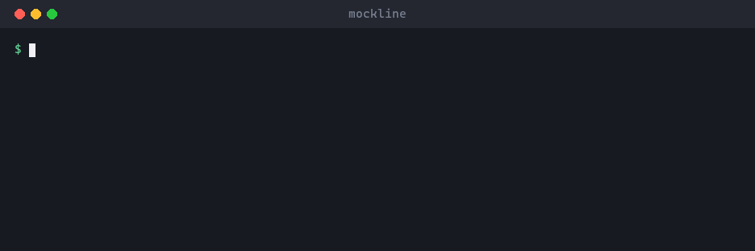

# Mockline

A local mock API server built from your OpenAPI file. Use it for development,
tests and demos.



## Features

- OpenAPI 3.0 and 3.1, YAML or JSON
- Responses from spec examples, or realistic data generated from schemas
- Request validation
- In-memory CRUD (create, read, update, delete)
- Custom responses, delays and errors
- Proxy to a real API
- Reloads when files change
- Usable as a CLI or a TypeScript library

## Install

Requires Node.js 20 or later.

```sh
npm install --global @zahid15/mockline
```

## Quick start

```sh
mockline init                  # create openapi.yaml and mockline.yaml
mockline serve openapi.yaml    # start at http://127.0.0.1:4010
```

Then open `http://127.0.0.1:4010/pets`.

Other commands:

```sh
mockline routes openapi.yaml   # list routes
mockline validate openapi.yaml # check the spec
mockline --help                # all options
```

## Common options

| Option                           | Description                           |
| -------------------------------- | ------------------------------------- |
| `--port <port>`                  | Port (default `4010`)                 |
| `--config <file>`                | Config file (default `mockline.yaml`) |
| `--stateful`                     | Keep created data in memory           |
| `--validate <off\|warn\|strict>` | Request validation (default `warn`)   |
| `--delay <ms>`                   | Add a delay to each response          |
| `--proxy <url>`                  | Send unknown routes to a real API     |
| `--watch`                        | Reload when files change              |

## Control a single request

| Header                   | Effect              |
| ------------------------ | ------------------- |
| `Prefer: code=404`       | Return status 404   |
| `Prefer: example=<name>` | Use a named example |
| `X-Mockline-Delay: 500`  | Wait 500 ms         |

## Use in code

```ts
import { createMockServer } from '@zahid15/mockline';

const server = await createMockServer({ spec: './openapi.yaml', port: 0 });
await fetch(`${server.url}/pets`);
await server.close();
```

## Docker

```sh
docker build -t mockline .
docker run --rm -p 4010:4010 -v "$PWD:/data:ro" \
  mockline serve /data/openapi.yaml --host 0.0.0.0
```

## Learn more

- [Configuration](docs/configuration.md)
- [How it works](docs/how-it-works.md)
- [Example project](examples/petstore)
- [Changelog](CHANGELOG.md)

## License

[MIT](LICENSE)
